# 보호자-환자 연결 설계 (G01)

**상태: 확정 (2026-11-21 개발자 확인).** Q1~Q15의 결정은 [progress.md](progress.md)에 있다. 이 문서는 그 결정과 현재 엔티티 코드를 기준으로 했다.

## 1. 추가 결정 (C1~C6)

Q1~Q15로 정해지지 않았던 부분을 개발자가 아래와 같이 확정했다.

| 번호 | 정한 것 | 결정 |
|---|---|---|
| C1 | 3번 틀렸을 때의 응답과 횟수 초기화 | 3번째 오답의 응답부터 429로 1분 막는다. 1분이 지나거나 연결에 성공하면 횟수는 0이 된다 |
| C2 | 코드 입력값 처리 | 서버가 앞뒤 공백을 지우고 대문자로 바꾼 뒤 검사한다. 6자리 형식이 아니면 400이고 실패 횟수에 넣지 않는다 |
| C3 | 내 약의 "보호자 작성" 표시 | 약 등록·수정은 내 약 목록에 표시한다. 중단한 약은 목록에서 사라지므로 표시하지 않는다 |
| C4 | 환자 쪽 API 경로 | `/api/my-guardian` (기존 `/api/my-medicines`와 같은 방식) |
| C5 | 환자에게 보이는 보호자 정보 | 보호자 닉네임 |
| C6 | 환자와 보호자가 같은 기록을 동시에 고칠 때 | 식사·배변·체중·수면은 나중에 저장한 값이 남는다. 내 약은 일정이 깨질 수 있어 행 잠금으로 한 명씩 처리한다 (5.4) |

## 2. ERD

기존 테이블은 관계와 이번에 바뀌는 컬럼 위주로 적었다. 모든 테이블의 `created_at`, `updated_at`은 생략했다.

```mermaid
erDiagram
    users ||--o| guardian_link : "patient_id"
    users ||--o{ guardian_link : "guardian_id"
    users ||--o| guardian_invite_code : "patient_id"
    users ||--o| guardian_code_attempt : "guardian_id"
    users ||--o{ guardian_link_history : "patient, guardian, disconnected_by"
    users ||--o{ meal_record : "user_id"
    users ||--o{ bowel_record : "user_id"
    users ||--o{ weight_record : "user_id"
    users ||--o{ sleep_record : "user_id"
    users ||--o{ food : "user_id"
    users ||--o{ user_medicine : "user_id"
    meal_record ||--o{ meal_food : "meal_record_id"
    food ||--o{ meal_food : "food_id"
    medicine ||--o{ user_medicine : "medicine_id"
    user_medicine ||--o{ medication_schedule : "user_medicine_id"
    user_medicine ||--o{ medication_log : "user_medicine_id"

    users {
        bigint id PK
        varchar username UK
        varchar nickname UK
        varchar role "PATIENT, GUARDIAN, OTHER"
    }
    guardian_link {
        bigint id PK
        bigint patient_id FK, UK
        bigint guardian_id FK
        timestamp connected_at
        varchar meal_access
        varchar bowel_access
        varchar medication_access
        varchar weight_access
        varchar sleep_access
    }
    guardian_link_history {
        bigint id PK
        bigint patient_id FK
        bigint guardian_id FK
        timestamp connected_at
        timestamp disconnected_at
        bigint disconnected_by_id FK
    }
    guardian_invite_code {
        bigint id PK
        bigint patient_id FK, UK
        varchar code UK
        timestamp expires_at
    }
    guardian_code_attempt {
        bigint id PK
        bigint guardian_id FK, UK
        int fail_count
        timestamp blocked_until
    }
    meal_record {
        bigint id PK
        bigint user_id FK
        bigint last_written_by_id FK "추가"
    }
    bowel_record {
        bigint id PK
        bigint user_id FK
        bigint last_written_by_id FK "추가"
    }
    weight_record {
        bigint id PK
        bigint user_id FK
        bigint last_written_by_id FK "추가"
    }
    sleep_record {
        bigint id PK
        bigint user_id FK
        bigint last_written_by_id FK "추가"
    }
    medication_log {
        bigint id PK
        bigint user_medicine_id FK
        bigint last_written_by_id FK "추가"
    }
    medication_schedule {
        bigint id PK
        bigint user_medicine_id FK
        bigint last_written_by_id FK "추가"
    }
    food {
        bigint id PK
        bigint user_id FK
        varchar name
    }
    meal_food {
        bigint id PK
        bigint food_id FK
        bigint meal_record_id FK
    }
    user_medicine {
        bigint id PK
        bigint user_id FK
        bigint medicine_id FK
        boolean deleted
    }
    medicine {
        bigint id PK
    }
```



### 새 테이블

| 테이블 | 역할 | 규칙 |
|---|---|---|
| `guardian_link` | 현재 연결과 공개 범위 | `patient_id` UNIQUE로 환자당 보호자 1명을 보장한다. 공개 범위 5개는 `PRIVATE`, `VIEW`, `EDIT` 중 하나이고 기본값은 `PRIVATE`다 |
| `guardian_link_history` | 해제 이력 | 해제할 때 한 줄을 넣고 `guardian_link` 행을 지운다. 공개 범위는 남기지 않는다 |
| `guardian_invite_code` | 환자별 현재 코드 | 환자당 한 줄이다. 재발급은 이 줄의 코드와 만료 시각을 바꾸므로 이전 코드가 바로 무효가 된다. 연결에 성공하면 지운다. 코드는 원문으로 저장한다 |
| `guardian_code_attempt` | 보호자별 입력 실패 횟수 | 서버를 재시작해도 유지되도록 DB에 둔다 |

### 기존 테이블 변경

- `meal_record`, `bowel_record`, `weight_record`, `sleep_record`, `medication_log`, `medication_schedule`에 `last_written_by_id`를 추가한다.
- 이 컬럼은 **NULL 허용**이다. `ddl-auto: update`로 기존 행이 있는 테이블에 추가해야 하기 때문이다. NULL은 환자 본인이 쓴 기록으로 본다.

## 3. API

공통 응답 형태와 날짜 형식은 기존 규칙을 따른다. 공개 범위 JSON은 아래 형태다.

```json
{ "meal": "PRIVATE", "bowel": "VIEW", "medication": "EDIT", "weight": "PRIVATE", "sleep": "VIEW" }
```

### 3.1 환자 API

`PATIENT`가 아니면 모두 404다.

| 메서드 | 경로 | 요청 | 응답 `data` | 실패 |
|---|---|---|---|---|
| GET | `/api/my-guardian` | | `{ guardianNickname, connectedAt, access }`, 연결이 없으면 `null` | |
| DELETE | `/api/my-guardian` | | `null` | 연결 없음 404 |
| GET | `/api/my-guardian/invite-code` | | `{ code, expiresAt }`, 유효한 코드가 없으면 `null` | |
| POST | `/api/my-guardian/invite-code` | | `{ code, expiresAt }` | 이미 연결됨 409 |
| PUT | `/api/my-guardian/access` | 공개 범위 5개 전부 | 공개 범위 | 값 오류 400, 연결 없음 404 |

### 3.2 보호자 연결 API

`GUARDIAN`이 아니면 모두 404다.

| 메서드 | 경로 | 요청 | 응답 `data` | 실패 |
|---|---|---|---|---|
| POST | `/api/guardian/patients` | `{ code }` | `{ patientId, nickname, connectedAt, access }` | 형식 400, 코드 404, 개수 초과·이미 연결 409, 입력 차단 429 |
| GET | `/api/guardian/patients` | | 위 객체의 배열 | |
| DELETE | `/api/guardian/patients/{patientId}` | | `null` | 연결 없음 404 |

### 3.3 보호자의 환자 기록 API

경로 앞부분은 `/api/guardian/patients/{patientId}`다. 요청·응답 본문은 기존 기록 API와 같다. 필요한 공개 범위를 만족하지 않으면 모두 404다. `EDIT`는 `VIEW`의 조회도 할 수 있다.

| 종류 | 메서드 | 경로 | 필요 범위 |
|---|---|---|---|
| 식사 | GET | `/record/meal?from&to`, `/record/meal/{id}` | VIEW |
| | POST, PUT, DELETE | `/record/meal`, `/record/meal/{id}` | EDIT |
| | GET | `/record/meal/foods` | EDIT |
| 배변 | GET | `/record/bowel?from&to`, `/record/bowel/{id}` | VIEW |
| | POST, PUT, DELETE | `/record/bowel`, `/record/bowel/{id}` | EDIT |
| 체중 | GET | `/record/weight?from&to` | VIEW |
| | PUT, DELETE | `/record/weight/{date}` | EDIT |
| 수면 | GET | `/record/sleep?from&to` | VIEW |
| | PUT, DELETE | `/record/sleep/{date}` | EDIT |
| 복약 | GET | `/record/medication/daily?date`, `/record/medication?from&to` | VIEW |
| | POST | `/record/medication/{userMedicineId}/{takenDate}/{doseNumber}/toggle` | EDIT |
| 내 약 | GET | `/medicines` | VIEW (복약) |
| | POST, PUT, DELETE | `/medicines`, `/medicines/{userMedicineId}` | EDIT (복약) |

약 검색은 기존 `GET /api/medicines`를 그대로 쓴다.

### 3.4 기존 응답에 추가되는 필드

환자 API와 보호자 API가 같은 응답을 쓴다. 기존 필드는 바뀌지 않는다.

| 응답 | 추가 필드 |
|---|---|
| `MealResponse`, `BowelResponse`, `WeightResponse`, `SleepResponse`, `MedicationLogResponse`, `UserMedicineResponse` | `writtenByGuardian: boolean` |
| `DailyMedicationResponse.Item` | `guardianWrittenDoses: number[]` (보호자가 체크한 회차) |

### 3.5 추가할 ErrorCode

| 이름 | 상태 | 문구 |
|---|---|---|
| `GUARDIAN_LINK_NOT_FOUND` | 404 | 연결 정보를 찾을 수 없습니다. |
| `GUARDIAN_ACCESS_NOT_FOUND` | 404 | 기록을 찾을 수 없습니다. |
| `INVITE_CODE_NOT_FOUND` | 404 | 초대 코드가 올바르지 않거나 만료되었습니다. |
| `INVITE_CODE_BLOCKED` | 429 | 1분 뒤 다시 시도해 주세요. |
| `GUARDIAN_PATIENT_LIMIT` | 409 | 환자는 2명까지 연결할 수 있습니다. |
| `PATIENT_ALREADY_LINKED` | 409 | 이미 보호자가 연결된 환자입니다. |
| `GUARDIAN_ALREADY_LINKED` | 409 | 연결된 보호자를 해제한 뒤 코드를 발급해 주세요. |

## 4. 동작 규칙

### 4.1 코드 발급

- `SecureRandom`으로 영문 대문자와 숫자 6자리를 만든다. 다른 행의 코드와 겹치면 다시 만든다.
- 만료 시각은 `Clock` 기준 10분 뒤다. 현재 시각이 만료 시각과 같거나 지나면 만료다.

### 4.2 코드 입력 순서

1. 역할 확인: `GUARDIAN`이 아니면 404
2. 보호자 행 잠금
3. 차단 확인: `blocked_until`이 지나지 않았으면 429
4. 개수 확인: 이미 2명이면 409. 코드를 확인하지 않으며 실패 횟수에도 넣지 않는다
5. 코드 행 잠금 후 확인: 없음·만료·사용됨이면 실패 횟수를 올리고 404. 3번째면 429
6. 환자 연결 확인: 이미 연결되어 있으면 409
7. 연결 생성(공개 범위 전부 비공개), 코드 삭제, 실패 횟수 초기화

### 4.3 접근 판단

- 권한은 토큰에 넣지 않고 요청마다 `guardian_link`를 읽는다. 해제나 공개 범위 축소가 다음 요청부터 바로 적용된다.
- 기존 서비스의 소유권 검사에 `patientId`를 넘긴다. 환자 A의 경로에 환자 B의 기록 id를 넣으면 기존 404가 그대로 난다.
- 비공개 종류의 기간 조회도 404다. 빈 목록은 "기록이 없다"로 오해될 수 있다.
- 보호자가 자기 기록 API(`/api/record/**`, `/api/my-medicines/**`)를 호출하면 404다. 기존 보호자 계정의 기록은 처리하지 않는다.

### 4.4 작성자

- 저장할 때마다 저장한 사람을 `last_written_by_id`에 넣는다. 환자가 고치면 "보호자 작성" 표시가 사라진다.
- `writtenByGuardian`은 이 값이 NULL이 아니고 기록 주인과 다를 때 `true`다.
- 체중·수면 덮어쓰기와 복약 체크의 복원도 저장으로 본다.
- 보호자가 입력한 음식은 환자의 음식 목록에 쌓인다.
- 해제 후에도 표시는 유지한다.

## 5. 구현 시 주의할 점

### 5.1 실패 횟수가 롤백되는 문제

`BusinessException`은 `RuntimeException`이라, 트랜잭션 안에서 던지면 실패 횟수 저장도 함께 롤백된다. 트랜잭션 안에서는 결과만 돌려주고, 커밋한 뒤에 예외를 던진다.

### 5.2 보호자당 환자 2명 제한

UNIQUE로 표현할 수 없으므로 코드 입력 시 보호자의 `users` 행을 `PESSIMISTIC_WRITE`로 잠근다. 현재 코드에 비관적 잠금을 쓰는 곳이 없어 G04에서 처음 도입한다.

### 5.3 G09 이후의 보호자 화면

G09부터 보호자 계정은 기존 홈·기록 API에서 404를 받는다. G19~G20이 끝날 때까지 개발 환경의 보호자 계정 화면에는 오류가 보인다.

### 5.4 내 약 동시 수정

`medication_schedule`에는 "현재 일정 1개"를 막는 DB 제약이 없다. (`UserMedicineService.java:76`의 주석은 유니크가 있다고 적혀 있지만 실제 제약은 없다.) 환자와 보호자가 같은 약을 동시에 수정하면 현재 일정이 2개가 될 수 있다. 그러면 `findCurrent`와 `findInEffectOn`이 결과 2개로 실패해 그 약의 수정·중단·체크가 500이 된다.

같은 약의 중복 등록도 `exists` 검사만 있어 동시에 들어오면 통과한다. G14에서 약 수정·중단은 `user_medicine` 행을, 약 등록은 환자의 `users` 행을 잠근다.

## 6. CLAUDE.md 추가 제안

CLAUDE.md는 개발자가 수정한다. 상태 코드 표의 429는 개발자가 이미 반영했다(`e664e76`). 아래 규칙은 아직 반영되지 않았다.

루트 `CLAUDE.md`의 동작 규칙에 추가:

```markdown
**보호자 연결**
- 설계: `docs/guardian/design.md` / 진행: `docs/guardian/progress.md`
- `PATIENT`와 `GUARDIAN`만 연결한다. 역할이 맞지 않으면 404다.
- 환자 1명당 보호자 1명, 보호자 1명당 환자 최대 2명이다. 초과하면 409다.
- 초대 코드는 10분 유효, 1회용이다. 없는·만료된·사용된 코드는 구분 없이 404다.
- 공개 범위는 기록 종류별 `PRIVATE`, `VIEW`, `EDIT`이며 연결·재연결 시 전부 `PRIVATE`다.
- 보호자의 비공개·권한 없는 요청은 모두 404다. 비공개 종류의 기간 조회도 404다.
- 보호자는 자기 기록이 없다. `/api/record/**`, `/api/my-medicines/**`를 호출하면 404다.
- `writtenByGuardian`은 마지막으로 저장한 사람 기준이다. 화면에는 "보호자 작성"으로만 표시하고 해제 후에도 유지한다.
```

## 7. features.json 변경 내역

Q4와 Q11의 결정에 따라 개발자 승인을 받아 아래 완료 조건을 추가했다.

| 항목 | 추가한 완료 조건 |
|---|---|
| G04 | 테스트: 코드를 3번 틀리면 429로 1분 막히고, 1분 뒤 다시 입력할 수 있다 |
| G14 | 동시성 테스트: 같은 약을 동시에 수정해도 현재 일정은 1개이고, 동시에 등록해도 활성 약은 1개다 |
| G19 | 브라우저 확인: 코드를 3번 틀리면 "1분 뒤 다시 시도" 안내가 보인다 |
